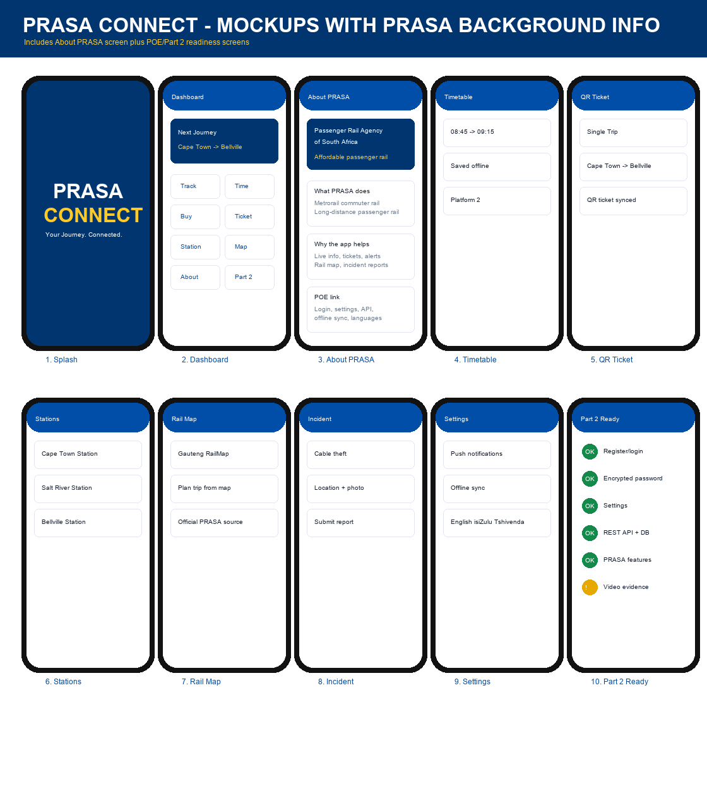

# PRASA Connect - OPSC6312 POE

An academic Android rail application using Kotlin/Compose, Supabase Auth, an authenticated REST API, PostgreSQL, private Supabase Storage and Firebase Cloud Firestore route sync. The source includes timetable search, bookings with QR codes, saved favourite routes, incidents with optional private photo uploads, offline report sync, settings, Google SSO wiring, FCM notification wiring and the official Gauteng rail map.

**Not an official PRASA product.** Seed schedules and fares are illustrative. Bookings are persisted academic records, not valid travel tickets. No payment or live train-tracking service is integrated.

## Group 10

- Sanele Manqoba Mazibuko (ST10444275)
- Nonhlanhla Chirwa (ST10451192)
- Ramudzuli Nyito (ST10450776)

## Submission status

See the [submission handover](docs/SUBMISSION_HANDOVER.md) for group roles, changes, evidence and final checklist, and the [Part 2 / Part 3 audit](docs/PART2_PART3_AUDIT.md) for requirement coverage. Source changes alone do not prove deployment or rubric completion. There is no hardcoded demo login; use a confirmed assessment account and share its password privately, never in Git.

## App design



## Demonstration video

The group supplied a demo link: [Watch PRASA Connect demo](https://youtu.be/Ef8ANPoGyB4). Confirm that the video plays for the assessor and includes the required narration, on-phone workflows and hosted-data evidence. Do not submit the walkthrough plan PDF in place of the recording.

- [Deployment and secrets](docs/DEPLOYMENT.md)
- [Publication and signing checklist](docs/PUBLICATION.md)
- [Release notes](docs/RELEASE_NOTES.md)
- [AI assistance statement](docs/AI_USE.md)
- [Verification results](docs/VERIFICATION.md)
- [Play Console readiness evidence steps](docs/PLAY_CONSOLE_EVIDENCE.md)

The POE requires Kotlin source on GitHub and explicitly disallows ZIP files as the source-code submission. Submit the repository link and requested PDFs/video through the official submission portal; use a ZIP only if the lecturer separately requests one for a different purpose.

## Architecture and design

Compose screens call PrasaRepository over HTTPS with OkHttp. Password handling belongs to Supabase Auth, not a custom password table. Android stores session credentials encrypted with an Android Keystore key and refreshes expiring sessions.

The prasa-api edge function validates the user access token and queries with that user's permissions. PostgreSQL RLS isolates profiles, bookings, reports and device tokens. Booking fare and ownership are server-controlled; request IDs prevent duplicate bookings on retries. Legacy demo tables are preserved but not exposed to authenticated clients.

SQLite stores account-partitioned cached reads and an incident outbox. Network failures can queue an incident; API validation/authentication failures cannot be disguised as offline success. WorkManager retries queued reports when connectivity returns and also checks periodically (15-minute minimum interval); stable report IDs make replays idempotent. Booking creation requires connectivity.

Google SSO uses a browser PKCE flow and registered deep link; the group reports successful sign-in after configuring the OAuth client. Firebase app configuration and protected FCM sender secrets are set; real device notification delivery still needs an acceptance test. English, Afrikaans and isiZulu labels are available; translations and all device workflows require review.

## Backend contract

Configured project: awbgflgcqjofsnagkzou. The authenticated API (version 7), private incident photo bucket, photo-path persistence and Supabase `firebase-token` bridge (version 1) were deployed on 5 November 2026. Google sign-in is reported working; phone-side route sync, notification delivery and two-user isolation still need recorded verification.

- Auth: Supabase /auth/v1/signup, password/refresh/PKCE token exchanges, logout.
- Public GET /functions/v1/prasa-api/ returns health information only.
- Authenticated API: GET /schedules, GET /tickets, POST /bookings, GET/POST /incidents, GET/PATCH /profile, GET /alerts, POST/DELETE /devices.
- Administrator-only POST /functions/v1/send-alert; private Storage bucket `incident-photos` enforces per-user folders and accepts JPEG/PNG/WebP up to 5 MB.
- POST /functions/v1/firebase-token verifies Supabase identity and issues a short-lived Firebase custom token using the same user UUID. Firestore `users/{uid}/saved_routes` reads/writes are scoped by `firestore.rules`; SQLite remains the offline source.
- New tables: profiles, bookings, reports, service_alerts, device_tokens; schedules retained.

No privileged credentials belong in Android source. The local migration filenames match the versions recorded by the connected Supabase project; the legacy demo-user seed is archived and excluded from deployment.

## Build and test

Open in Android Studio with JDK 21 and Android SDK 36. Configure the provider details in DEPLOYMENT.md. Run:

```powershell
.\gradlew.bat :app:testDebugUnitTest :app:lintDebug :app:assembleDebug --no-daemon
.\gradlew.bat :app:connectedDebugAndroidTest --no-daemon
```

The second command requires an emulator/device. Unit tests cover validation and language selection; instrumentation tests cover durable account-isolated offline records and intercepted HTTP authentication, refresh, logout and rejection paths. Manual two-user API/security and provider integration tests are still required.

GitHub Actions builds, runs unit tests/lint, runs emulator tests and uploads reports/APKs. A separate workflow type-checks the edge functions. Production deployment is manual and gated on a reviewed migration history. Configure the production environment's reviewers and secrets before use.

## References and evidence

Official documentation links are in DEPLOYMENT.md. The supplied PRASA logo and Gauteng map are reference assets, not evidence of affiliation. Map source: https://www.prasa.com/admin/wp-content/uploads/2024/12/RailMap-Gauteng.png

Use actual build results, CI run links and physical-device screenshots for submission. Older design PDFs and screenshots describe earlier work and must not be presented as evidence that the new integration has been verified.
